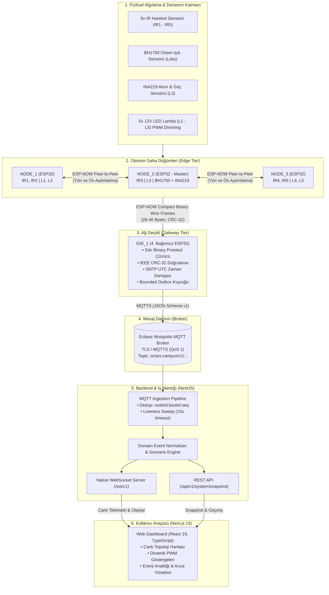

# 💡 IoT Tabanlı Adaptif Akıllı Kampüs Aydınlatma ve Arıza Tespit Sistemi
### *IoT-Based Adaptive Smart Campus Lighting & Fault Detection System*

[](https://www.espressif.com/)
[](https://www.espressif.com/en/solutions/low-power-solutions/esp-now)
[-660066?style=for-the-badge&logo=eclipsemosquitto&logoColor=white)](https://mosquitto.org/)
[-000000?style=for-the-badge&logo=nextdotjs&logoColor=white)](https://nextjs.org/)
[](https://nestjs.com/)
[](https://www.typescriptlang.org/)
[](https://platformio.org/)
[](https://www.docker.com/)

---

## 📌 Proje Özeti (Executive Summary)

**Smart Campus Adaptive Lighting**, geleneksel açık alan sokak ve kampüs aydınlatmalarının sebep olduğu yüksek enerji israfını, ışık kirliliğini ve kör nokta kazalarını önlemek amacıyla geliştirilmiş **uç bilişim (Edge Computing) destekli, yön tahminli ve arıza izlemeli yeni nesil bir IoT aydınlatma ekosistemidir.**

Sistem; 4 adet ESP32 mikrodenetleyicisi (3 otonom saha düğümü + 1 ağ geçidi), yönlü kızılötesi (IR) hareket sensörleri, ortam ışığı sensörü (BH1750), hassas elektriksel güç/akım sensörü (INA219), MOSFET PWM sürücüleri, Mosquitto MQTT broker, NestJS backend ve Next.js tabanlı gerçek zamanlı bir dijital ikiz web paneli (Dashboard) içermektedir.

> **Temel Mühendislik Yaklaşımı: *"Local-first, Edge-autonomous, Cloud-ready"***  
> İnternet bağlantısı veya merkezi sunucu çökse dahi, saha düğümleri kendi aralarında **ESP-NOW** protokolü üzerinden haberleşerek yön tahminli aydınlatmayı kesintisiz sürdürür.

---

## 🚀 Öne Çıkan Özellikler (Key Highlights)

- 🧭 **Yön Kestirimli Adaptif Aydınlatma (Directional Predictive Lighting):** Hareket algılandığında yalnızca bulunulan lamba değil; hareket yönündeki bir sonraki lamba, kişi veya araç henüz oraya ulaşmadan önce kademeli olarak %60 ön aydınlatma (pre-lighting) seviyesine getirilir.
- ⚡ **Otonom Uç Karar Mekanizması (Edge Autonomy):** Düğümler arasındaki haberleşme harici bir router ya da internete ihtiyaç duymayan 2.4 GHz **ESP-NOW** protokolü ile sağlanır (Gecikme < 10 ms).
- 🛰️ **Özel Ağ Geçidi (Dedicated Gateway - `GW_1`):** 4. bağımsız ESP32 kartı; düğümlerden gelen sıkıştırılmış ikili (binary) paketleri doğrular (IEEE CRC-32, MAC allowlist), SNTP ile UTC zaman damgası ekler ve TLS şifreli MQTTS ile broker'a aktarır.
- 📊 **Gerçek Zamanlı Çift Yönlü Dijital İkiz (Digital Twin Dashboard):** WebSocket (`/ws/v1`) üzerinden milisaniye düzeyinde canlı lamba parlaklıkları, canlı topoloji haritası, düğüm durumları ve anlık telemetri akışı.
- 🔌 **Fiziksel Ölçüm & Analitik (Measured vs Estimated Energy):** `NODE_2` üzerindeki INA219 ile fiziksel akım/voltaj/güç tüketimi (`MEASURED`) okunur; diğer lambalar matematiksel modellerle (`ESTIMATED`) doğrulanarak sistem geneli tasarruf hesabı çıkarılır.
- 🛡️ **Akıllı Arıza & Liveness Tespiti:** 15 saniyelik liveness kontrolü (3 kaçırılan heartbeat), hat koptuğunda otomatik `OFFLINE` alarmı, aşırı akım veya CRC hata raporlaması.
- 🎮 **Yerleşik Senaryo & Simülasyon Motoru:** Fiziksel donanım bağlı olmasa dahi *"Yaya Yürüyüşü"*, *"Hızlı Araç Geçişi"*, *"Düğüm Arızası"* gibi senaryoları uçtan uca simüle edebilme imkanı.

---

## 🖥️ Arayüz ve Dashboard Önizlemesi (Web Interface)

Sistem; modern, koyu temalı (dark mode), mikro animasyonlara sahip ve operasyonel kararları kolaylaştıran Next.js tabanlı bir yönetim paneline sahiptir:

### 1. Genel Bakış ve Metrikler (Overview Dashboard)
*Gerçek zamanlı enerji tasarrufu yüzdesi, anlık çekilen güç (W), aktif düğüm/lamba sayıları ve son sistem telemetrileri:*


### 2. Kampüs Topolojisi ve Canlı Durum Haritası (System Topology)
*Saha düğümlerinin, IR sensörlerinin ve lambaların (L1-L5) canlı fiziksel yerleşimi, parlaklık seviyeleri ve komşuluk bağları:*


### 3. Senaryo Yönetimi ve İnteraktif Simülatör (Interactive Simulation)
*Farklı hareket ve arıza durumlarının canlı simülasyonunu başlatan kontrol paneli:*


### 4. Arıza & Uyarı Takip Merkezi (Alerts & Fault Monitoring)
*Kritiklik derecelerine göre filtrelenen sistem uyarıları, paket kayıpları ve donanım arızaları:*


### 5. Canlı Telemetri ve Mesaj Logları (Live Telemetry Logs)
*Gateway ve düğümlerden gelen MQTT ve WebSocket olaylarının anlık ham veri kaydı:*


---

## 🛠️ Donanım ve Prototip Mimarisi (Hardware Prototype)

Sistem prototipi laboratuvar ortamında gerçek donanım bileşenleriyle kurulmuş ve doğrulanmıştır:

| Çalışma Masası Test Düzeneği | ESP32 Düğüm Ağı & Kablolama |
|:---:|:---:|
|  |  |
| **Sensör ve Ölçüm Katmanı (BH1750, INA219, IR)** | **İlk Breadboard Devre Doğrulaması** |
|  |  |

> 📖 **Detaylı Pinout ve Devre Şeması:** Donanım bileşenleri, GPIO haritaları ve elektriksel güvenlik kuralları için [`hardware/README.md`](hardware/README.md) dosyasını inceleyebilirsiniz.

---

## 📐 Uçtan Uca Sistem Mimarisi (System Architecture)

Aşağıdaki şema, fiziksel sensör algılamasından web dashboard arayüzüne kadar uzanan veri akışını özetlemektedir:



---

## ⚙️ Akıllı Aydınlatma Durum Mantığı (State Machine)

Sistemdeki lambalar aşağıdaki durum geçişlerine göre yönetilir:

```
[ GÜNDÜZ MODU ] (BH1750 > 50 Lux) ──> Lambalar tamamen KAPALI (0% PWM)
        │
        ▼ (BH1750 <= 50 Lux)
[ GECE BEKLEME ] ───────────────────> Güvenlik seviyesi (%10 - %20 PWM)
        │
        ├─► [Ön Aydınlatma Talebi] ──> Komşu düğümden sinyal geldi: %60 PWM
        │
        ▼ [Doğrudan Hareket Algılandı]
[ AKTİF AYDINLATMA ] ────────────────> İlgili lamba anında %100 PWM
        │
        ▼ (Hareket bitti, Gecikme sayacı: 15s)
[ KADEMELİ SÖNME (Dimming) ] ────────> 3 saniyede yumuşak geçişle Bekleme Seviyesine (%10-20)
```

---

## 🧱 Kullanılan Teknolojiler ve Araçlar (Tech Stack)

### 1. Gömülü Sistemler ve Donanım (Embedded & Firmware)
| Teknoloji / Araç | Sürüm / Detay | Kullanım Amacı |
|---|---|---|
| **ESP32 DevKit V1** | Xtensa Dual-Core | Otonom düğüm kontrolü ve kablosuz haberleşme |
| **PlatformIO Core** | `6.1.19` | Modüler C++17 firmware geliştirme, derleme ve CI ortamı |
| **ESP-IDF / Arduino** | `espressif32@7.0.1` | Donanım sürücüleri, PWM (LEDC), I2C ve Wi-Fi yığını |
| **ESP-NOW** | 2.4 GHz Proprietary | Düğümler arası router'sız ultra hızlı (<10ms) haberleşme |
| **Unity Test Framework** | C++ Native | Gateway ve node çekirdek mantığı için donanımsız native birim testleri |
| **Sensörler** | BH1750, INA219, IR | Ortam ışığı, elektriksel güç ölçümü ve yönlü hareket algılama |

### 2. Sunucu ve Veri Hattı (Backend & Ingestion)
| Teknoloji / Araç | Sürüm / Detay | Kullanım Amacı |
|---|---|---|
| **NestJS** | v11 | Kurumsal düzeyde ölçeklenebilir backend mimarisi |
| **Eclipse Mosquitto** | v2.0 (Docker) | Hafif, yüksek performanslı MQTT broker (QoS 1) |
| **Native WebSocket** | RFC 6455 (`/ws/v1`) | Dashboard için sıfır gecikmeli gerçek zamanlı çift yönlü veri akışı |
| **Node.js** | v22.x LTS | Backend çalışma zamanı ortamı |
| **TypeScript** | v5.7+ | Uçtan uca tip güvenliği ve paylaşımlı sözleşmeler (`@smart-campus/contracts`) |

### 3. Kullanıcı Deneyimi ve Arayüz (Frontend & UI)
| Teknoloji / Araç | Sürüm / Detay | Kullanım Amacı |
|---|---|---|
| **Next.js** | 15 (App Router) | Yüksek performanslı React web uygulaması |
| **React** | 19 | Bileşen tabanlı reaktif durum yönetimi |
| **Modern Vanilla CSS & Tailwind** | Modern Dark UI | Glassmorphism, akıcı geçiş animasyonları ve responsive yerleşim |
| **Lucide Icons** | SVG İkon Seti | Modern ve anlaşılır sistem ikonografisi |

---

## 📁 Repository Dosya Yapısı (Clean Structure)

Gereksiz dosyalar temizlenmiş, anlaşılır ve modüler dosya yapısı:

```text
smart-campus-adaptive-lighting/
├── assets/                          # Görsel varlıklar ve ekran görüntüleri
│   ├── dashboard/                   # Web arayüzü ekran görüntüleri (5 adet)
│   └── hardware/                    # Donanım prototipi ve laboratuvar fotoğrafları (4 adet)
├── dashboard/                       # Tam teşekküllü web yönetim paneli & backend
│   ├── backend/                     # NestJS backend servisi (MQTT alıcı, WS sunucusu, REST)
│   ├── frontend/                    # Next.js 15 web arayüzü (Topoloji, Metrikler, Simülatör)
│   ├── packages/contracts/          # Backend, Frontend ve Firmware ortak TypeScript sözleşmeleri
│   ├── infrastructure/              # Mosquitto MQTT Docker Compose yapılandırması
│   ├── deployment/                  # Canlıya alma (production) scriptleri ve compose dosyaları
│   └── docs/                        # Detaylı mimari karar kayıtları (ADR'ler) ve entegrasyon dokümanları
├── docs/                            # Proje teknik dokümantasyonu
│   └── project-overview.md          # Proje genel teknik şartnamesi ve detaylı kapsamı
├── firmware/                        # ESP32 C++17 gömülü yazılımları
│   ├── gateway/                     # GW_1 Ağ Geçidi firmware kodu (ESP-NOW -> MQTTS köprüsü)
│   ├── node/                        # NODE_1, NODE_2, NODE_3 ortak firmware kodu (PlatformIO profilli)
│   ├── shared/                      # İkili (binary) protokol kodlayıcı ve IEEE CRC-32 kütüphanesi
│   ├── integration/                 # Donanım doğrulama kontrol listeleri ve bağlantı örnekleri
│   └── test-vectors/                # Firmware ve backend arasındaki sözleşme doğrulama JSON vektörleri
├── hardware/                        # Donanım pinout kılavuzu ve elektriksel güvenlik rehberi
│   └── README.md                    # Pin haritaları, BOM listesi ve donanım açıklamaları
├── presentation/                    # Sunum dosyaları ve ESP32 eğitim slaytları
│   ├── ESP32_Gomulu_Sistemlere_Giris.pptx
│   └── ESP32__Rehber_SSS.pdf
├── .gitignore                       # Git yoksayma kuralları
└── README.md                        # Ana proje tanıtım ve vitrin dokümanı (Bu dosya)
```

---

## 🔬 Mühendislik Kararları ve Teknik Detaylar (Engineering Highlights)

1. **Paket Boyutu & Wire Budget:**  
   ESP-NOW paket boyutu hedefi maksimum 220 bayttır. JSON formatı 275 baytı aştığı için, firmware katmanında little-endian ikili (binary) bir protokol geliştirilmiştir:
   - Kalp Atışı (Heartbeat): **28 bayt**
   - Lamba Durumu (Lamp State): **30 bayt**
   - Sensör Olayı (Sensor Event): **31 bayt**
   - Elektriksel Ölçüm (Electrical): **40 bayt**
   Tüm paketler donanım düzeyinde 4 baytlık **IEEE CRC-32** ile korunur.
2. **Kusursuz Tekilleştirme (Deduplication):**  
   Paket kayıplarını ve kablosuz tekrarları önlemek için ESP32'nin kalıcı NVS hafızasında saklanan `BOOT_XXXXXXXX` sayaçları kullanılır. Her mesaj benzersiz `nodeId:bootId:sequence` anahtarına sahiptir. Backend mükerrer paketleri veritabanına ya da arayüze iletmeden eler.
3. **Fail-Safe Mekanizması:**  
   Gateway bağlantısı kopsa dahi lamba kontrolü kesilmez. Node sensör arızası yaşarsa (ör. IR sensör sürekli HIGH kalırsa), güvenlik zaman aşımı (15 saniye) devreye girerek lambanın sonsuza kadar açık kalmasını engeller.
4. **PlatformIO Çoklu Profil Mimarisi:**  
   Tek bir kod tabanından derleme bayrakları (`-D SMART_CAMPUS_NODE_ID=1/2/3`) ile 3 farklı düğümün ve ağ geçidinin yazılımı tek komutla üretilebilir.

---

## 🚦 Kurulum ve Hızlı Başlangıç (Quick Start Guide)

Projeyi donanım olmadan da bilgisayarınızda **Mock Senaryo Modu** ile doğrudan çalıştırıp dashboard'u test edebilirsiniz.

### Gereksinimler
- Node.js (v22.x LTS önerilir)
- Docker Desktop (MQTT Mosquitto için)
- Python 3.11+ (Firmware testleri için opsiyonel)

### 1. Dashboard ve Backend'i Çalıştırma

```powershell
# Dashboard dizinine gidin
cd dashboard

# Bağımlılıkları yükleyin
npm install

# Mosquitto MQTT Broker'ı Docker ile ayağa kaldırın
npm run infra:up

# Ortak paketleri ve sözleşmeleri derleyin
npm run build

# Geliştirme ortamını başlatın (Frontend http://localhost:3000, Backend http://localhost:3001)
npm run dev
```

Tarayıcınızda `http://localhost:3000` adresine giderek **Topoloji, Senaryolar, Arıza Uyarıları ve Logları** canlı olarak deneyimleyebilirsiniz!

### 2. Firmware Birim Testlerini Çalıştırma (Native C++)

PlatformIO ve GCC kurulu bir ortamda donanıma ihtiyaç duymadan C++17 çekirdek testlerini çalıştırabilirsiniz:

```powershell
cd firmware
pio test -d gateway -e native
pio test -d node -e native
```

---

## 👨‍💻 Proje Geliştiricisi

**Osman Melih Gümüş**  
*Bilgisayar Mühendisliği Öğrencisi & Gömülü Sistem / IoT Geliştirici*  
- **GitHub:** [@osmnmlh](https://github.com/osmnmlh)  
- **Proje Konusu:** IoT Tabanlı Adaptif Akıllı Kampüs Aydınlatma ve Arıza Tespit Sistemi

---

<p align="center">
  <i>Bu proje; düşük güç tüketimli uç bilişim, dağıtık kablosuz ağlar (ESP-NOW), güvenilir IoT mesajlaşması (MQTT) ve modern reaktif web teknolojilerini bir araya getiren uçtan uca eksiksiz bir mühendislik çalışmasıdır.</i>
</p>
