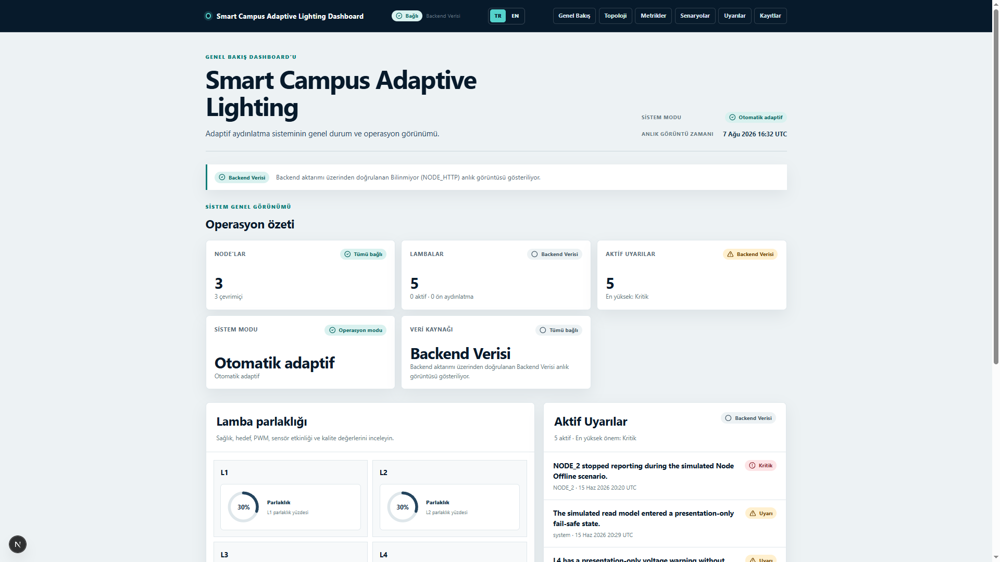
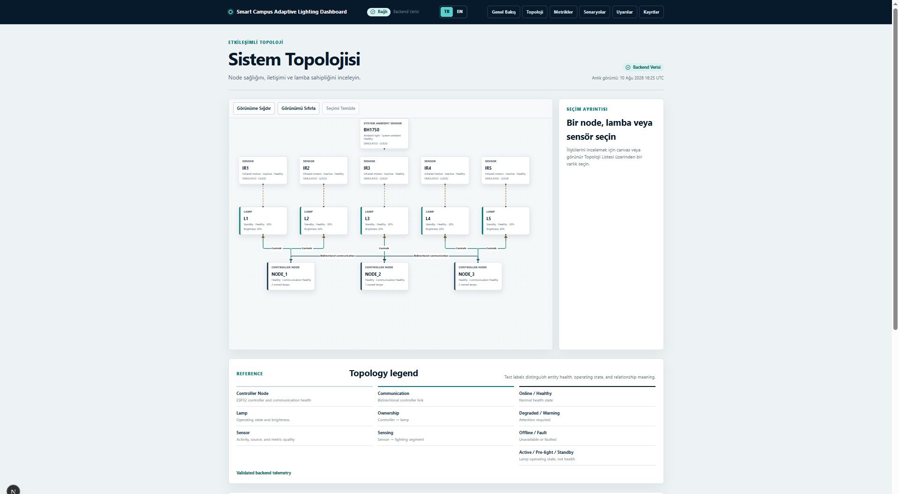
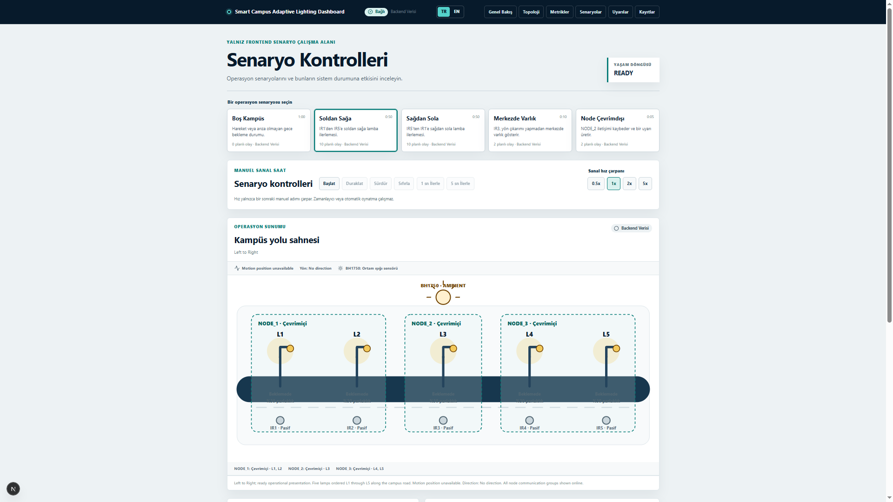
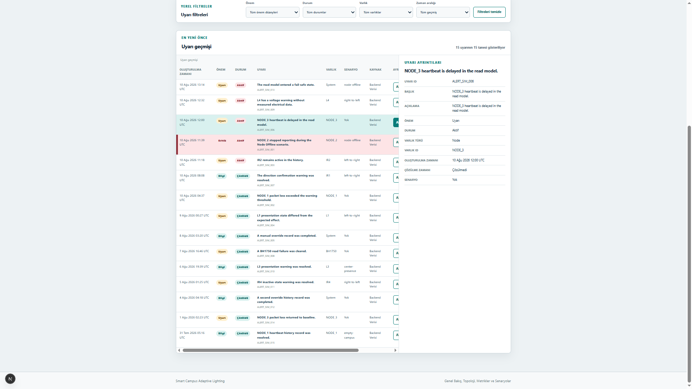
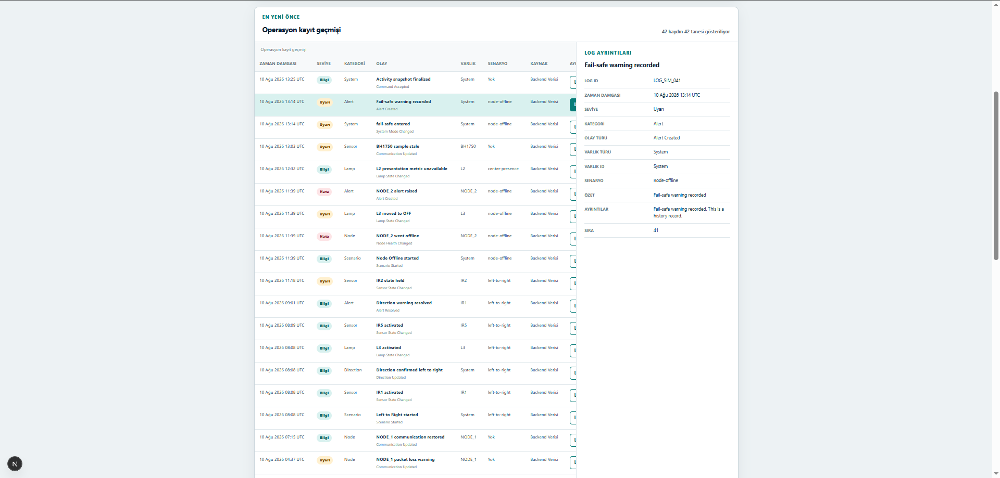
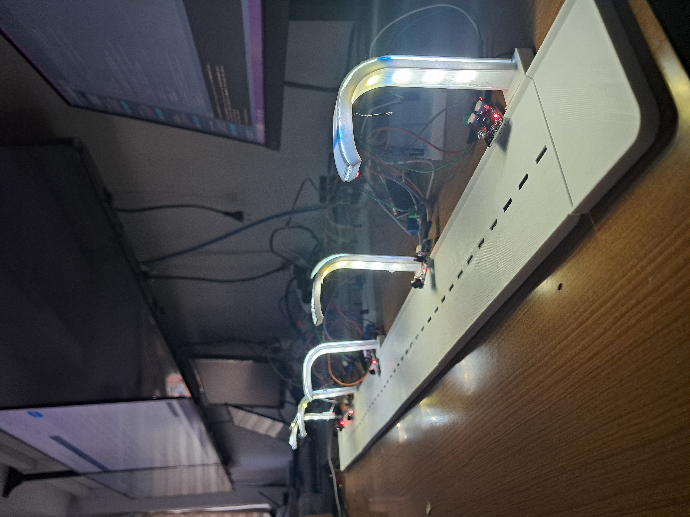
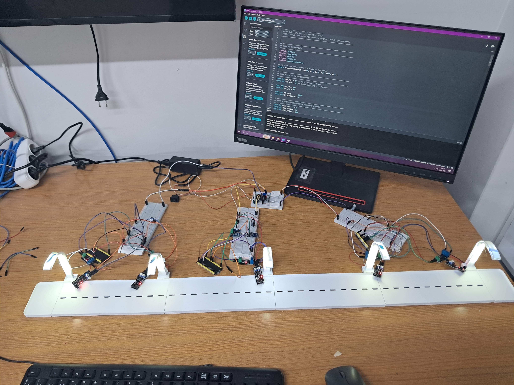
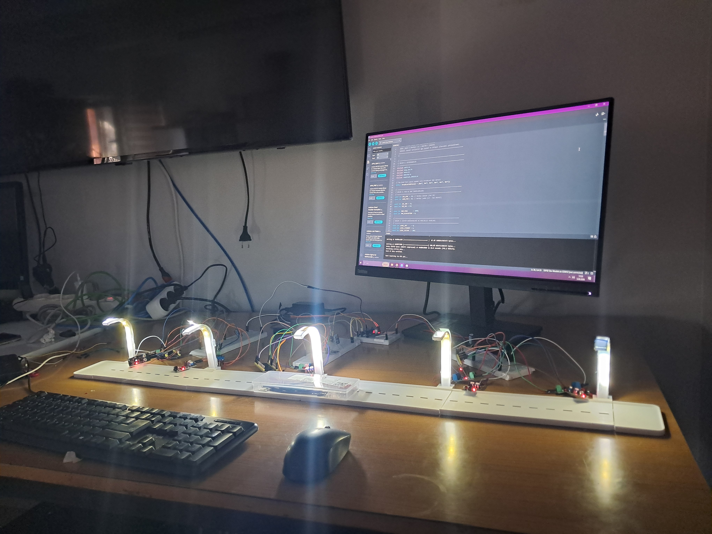
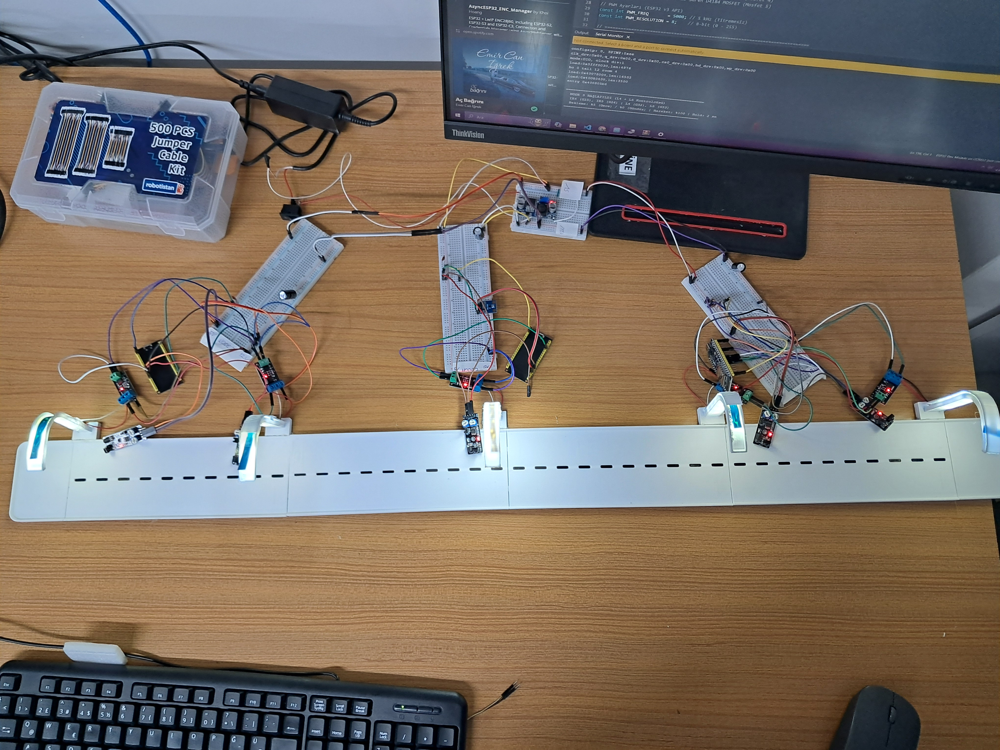
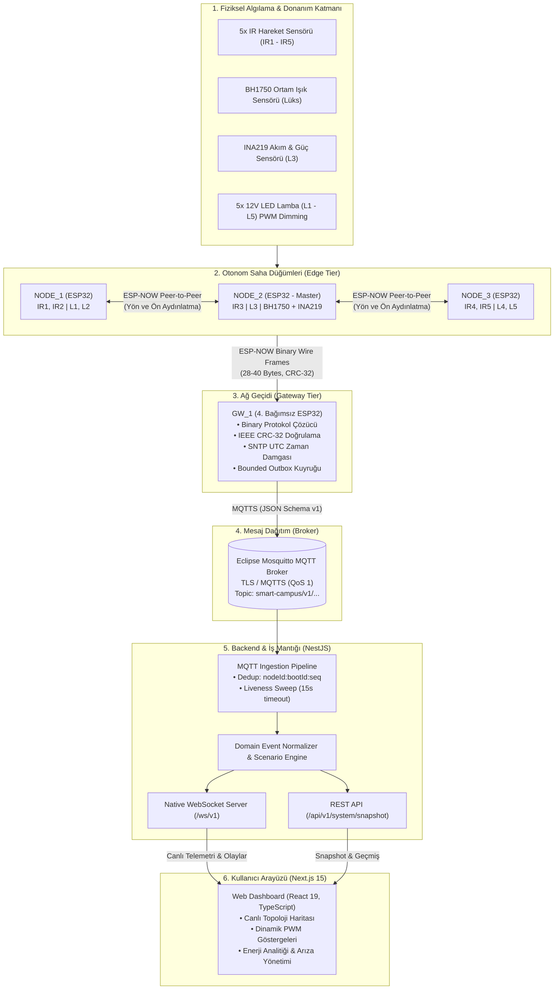

# 💡 IoT Tabanlı Adaptif Akıllı Kampüs Aydınlatma ve Arıza Tespit Sistemi
### *IoT-Based Adaptive Smart Campus Lighting & Fault Detection System*

[](LICENSE)
[](https://www.espressif.com/)
[](https://www.espressif.com/en/solutions/low-power-solutions/esp-now)
[-660066?style=for-the-badge&logo=eclipsemosquitto&logoColor=white)](https://mosquitto.org/)
[-000000?style=for-the-badge&logo=nextdotjs&logoColor=white)](https://nextjs.org/)
[](https://nestjs.com/)
[](https://www.typescriptlang.org/)
[](https://platformio.org/)
[](https://www.docker.com/)

---

## 📌 Proje Özeti (Executive Summary)

Bu proje; açık alan kampüs, yol ve otopark aydınlatmalarında sabit parlaklıktan kaynaklanan gereksiz enerji tüketimini ve kör nokta güvenlik problemlerini çözmek amacıyla geliştirilmiş **uç bilişim (Edge Computing) destekli, yön kestirimli ve arıza izlemeli bir IoT aydınlatma prototipidir.**

Sistem; 4 adet ESP32 mikrodenetleyicisi (3 saha kontrol düğümü + 1 ağ geçidi), yönlü kızılötesi (IR) hareket sensörleri, ortam ışığı sensörü (BH1750), elektriksel ölçüm sensörü (INA219), MOSFET PWM sürücüleri, Mosquitto MQTT broker, NestJS backend ve Next.js tabanlı gerçek zamanlı bir dijital ikiz web paneli (Dashboard) içermektedir.

> **Temel Yaklaşım: *"Local-first, Edge-autonomous, Cloud-ready"***  
> Düğümler yön ve hareket sinyalleşmesini internete ya da merkezi bir router'a ihtiyaç duymadan doğrudan **ESP-NOW** üzerinden yürütür. Gateway ya da bulut bağlantısı kopsa dahi saha aydınlatması kesintiye uğramaz.

---

## 🚀 Öne Çıkan Özellikler (Key Highlights)

- 🧭 **Yön Kestirimli Adaptif Aydınlatma (Directional Predictive Lighting):** Hareket algılandığında yalnızca bulunulan lamba değil, hareket yönündeki bir sonraki lamba da kişi/araç henüz oraya ulaşmadan önce kademeli olarak %60 ön aydınlatma (pre-lighting) seviyesine getirilir.
- ⚡ **Otonom Uç Karar Mekanizması (Edge Autonomy):** Düğümler arasındaki koordinasyon 2.4 GHz **ESP-NOW** protokolü ile sağlanır (Gecikme < 10 ms).
- 🛰️ **Ayrık Ağ Geçidi (Dedicated Gateway - `GW_1`):** 4. bağımsız ESP32 kartı; düğümlerden gelen sıkıştırılmış ikili (binary) paketleri doğrular (IEEE CRC-32, MAC allowlist), SNTP ile UTC zaman damgası ekler ve TLS şifreli MQTTS ile broker'a aktarır.
- 📊 **Çift Yönlü Dijital İkiz (Digital Twin Dashboard):** WebSocket (`/ws/v1`) üzerinden lamba parlaklıkları, saha topolojisi, düğüm durumları ve telemetri akışı izlenir.
- 🔌 **Fiziksel Ölçüm & Analitik (Measured vs Estimated Energy):** `NODE_2` üzerindeki INA219 ile fiziksel akım/voltaj/güç tüketimi (`MEASURED`) okunur; diğer lambalar matematiksel modellerle (`ESTIMATED`) doğrulanarak sistem geneli tasarruf hesabı çıkarılır.
- 🛡️ **Arıza & Liveness Tespiti:** 15 saniyelik liveness kontrolü (3 kaçırılan heartbeat) ile hat koptuğunda otomatik `OFFLINE` durumu ve aşırı akım/açık devre alarmları üretilir.
- 🎮 **Yerleşik Senaryo & Simülasyon Motoru:** Fiziksel donanım bağlı olmasa dahi *"Yaya Yürüyüşü"*, *"Hızlı Araç Geçişi"*, *"Düğüm Arızası"* gibi durumlar uçtan uca simüle edilebilir.

---

## 🏭 Prototip Mimarisi vs. Endüstriyel Saha Gerçekleri (Gap Analysis)

Bu çalışma, laboratuvar ölçeğinde mimari yaklaşımı doğrulamak için geliştirilmiş bir **donanım prototipidir (PoC / MVP)**. Endüstriyel saha uygulamaları ile mevcut prototip arasındaki farklar ve üretim yol haritası aşağıda şeffafça özetlenmiştir:

| Mimari Katman | Bu Prototipteki Yaklaşım | Endüstriyel Aydınlatma Standardı | Üretime Yönelik Öngörülen Geçiş |
|---|---|---|---|
| **Armatür Gerilimi** | 12V DC LED Şerit / Modül | 230V AC Şebeke Gerilimi | Şebeke gerilimi uyumlu izole endüstriyel LED sürücü (Driver) |
| **Dimleme Arayüzü** | D4184 Logic-Level MOSFET (PWM) | **DALI-2 (IEC 62386)**, D4i veya **0-10V / 1-10V** | Mikrodenetleyici PWM çıkışı yerine izole DALI-2 transceiver (ör. MAX14827) veya 0-10V analog dönüştürücü |
| **Mekanik Soket & Arayüz** | Breadboard / Doğrudan Kablolama | **Zhaga Book 18** veya **NEMA ANSI C136.41 (7-pin)** | Armatür üstü standart Zhaga/NEMA yuvalı tak-çıkar kontrolcü nod tasarımı |
| **Geniş Alan İletişimi** | ESP-NOW (P2P Mesh, ~100m) | **LoRaWAN**, **NB-IoT** veya **PLC** (Power Line) | Kampüs içi ESP-NOW korunabilir; geniş coğrafi/şehir hatlarında LoRaWAN veya hücresel (NB-IoT/LTE-M) hibrit ağ geçidi |
| **Koruma & İzolasyon** | Laboratuvar açık devre | **IP66 / IP67**, **IK08/IK10**, **10 kV SPD (Parafudr)** | Aşırı gerilim/yıldırım koruması ve dış ortam sızdırmaz döküm alüminyum gövde |
| **Ölçüm Doğruluğu** | INA219 (I2C şönt dirençli) | Class 1 / Class 0.5 Enerji Ölçüm IC (MID uyumlu) | ANSI C136.52 / D4i enerji raporlama standartlarına uygun metroloji katmanı |

> **Mühendislik Notu:** 12V DC ve MOSFET tabanlı mimari; düşük gerilim güvenliği, laboratuvar ortamında hızlı yineleme ve mantıksal doğrulama amacıyla seçilmiştir. Yazılım durum makinesi, dedup mantığı ve ağ geçidi katmanı DALI-2 veya 0-10V sürücü entegrasyonuna hazır mimaridedir.

---

## 💡 Aydınlatma Standartları ve Mühendislik Tercihleri

Bir aydınlatma sistemi yalnızca yazılımdan ibaret değildir; fotometrik regülasyonlar ve kullanıcı konforu standartlarına uygunluk esastır:

### 1. Yol Aydınlatma Sınıfları (EN 13201 Uyumu)
Avrupa standardı **EN 13201-2**, yaya ve düşük hızlı araç yolları için aydınlatma sınıflarını (P1 - P6) belirler. 
* Projede gece bekleme modu için seçilen **%10 - %20 bekleme seviyesi**, kullanıcı yokken enerji tasarrufu sağlarken yolda sıfır karanlık oluşturmayarak EN 13201 asgari aydınlık düzeyini (Eav) korumak üzere belirlenmiştir.
* Hareket algılandığında sistem hedef sınıfın tam parlaklık gereksinimine (%100) çıkar; hareket sona erdiğinde ani kararma yerine 15 saniyelik tutma süresi ve 3 saniyelik kademeli geçişle bekleme seviyesine döner.

### 2. PWM Frekansı ve Titreme (IEEE 1789-2015 Flicker Standardı)
Düşük frekanslı PWM anahtarlaması insan gözünde görünür veya stroboskopik titremeye (flicker), baş ağrısına ve kamera kayıtlarında parazite sebep olur.
* Sistemde ESP32 LEDC PWM donanım frekansı **5 kHz** olarak ayarlanmıştır.
* Bu değer, **IEEE 1789-2015** ("Recommended Practices for Modulating Current in LEDs") standardında tanımlanan *"Flicker - No Observable Effect"* (Gözlemlenebilir Etki Yok) sınırları içerisinde kalmayı sağlar.

### 3. Zemin Lüksü vs. Ortam Işığı Ölçümü
* Prototipte `NODE_2` üzerine entegre edilen **BH1750**, armatür seviyesindeki ortam ışığını (Gündüz/Gece geçişi için) ölçer.
* Gerçek saha aydınlatma projelerinde zemin aydınlık seviyesi fotometrik dağılım eğrileri (IES/LDT), direk yüksekliği, montaj açısı ve zemin yansıtma katsayısına göre hesaplanır (Dialux vb.). Sistem mimarisinde bu hesaplama eşik değerleri parametrik olarak yapılandırılabilir tutulmuştur.

### 4. Elektromanyetik Uyumluluk (EMC)
Yüksek frekanslı anahtarlama devrelerinin endüstriyel ortamlarda **EN 55015** (Radyo parazit sınırları) ve **EN 61547** (Bağışıklık) standartlarını karşılaması gerekir. Prototip devrelerinde LC filtreleme ve dekuplaj kondansatörleri kullanılmıştır.

---

## 🖥️ Arayüz ve Dashboard Önizlemesi (Web Interface)

Sistem; koyu temalı, mikro animasyonlara sahip ve operasyonel kararları kolaylaştıran Next.js tabanlı bir yönetim paneline sahiptir:

### 1. Genel Bakış ve Metrikler (Overview Dashboard)
*Gerçek zamanlı enerji tasarrufu yüzdesi, anlık çekilen güç (W), aktif düğüm/lamba sayıları ve son sistem telemetrileri:*


### 2. Kampüs Topolojisi ve Canlı Durum Haritası (System Topology)
*Saha düğümlerinin, IR sensörlerinin ve lambaların (L1-L5) canlı fiziksel yerleşimi, parlaklık seviyeleri ve komşuluk bağları:*


### 3. Senaryo Yönetimi ve İnteraktif Simülatör (Interactive Simulation)
*Farklı hareket ve arıza durumlarının canlı simülasyonunu başlatan kontrol paneli:*


### 4. Arıza & Uyarı Takip Merkezi (Alerts & Fault Monitoring)
*Kritiklik derecelerine göre filtrelenen sistem uyarıları, paket kayıpları ve donanım arızaları:*


### 5. Canlı Telemetri ve Mesaj Logları (Live Telemetry Logs)
*Gateway ve düğümlerden gelen MQTT ve WebSocket olaylarının anlık ham veri kaydı:*


---

## 🛠️ Donanım ve Prototip Mimarisi (Hardware Prototype)

Sistem prototipi laboratuvar ortamında kurulan donanım bileşenleriyle test edilmiştir:

| Çalışma Masası Test Düzeneği | ESP32 Düğüm Ağı & Kablolama |
|:---:|:---:|
|  |  |
| **Sensör ve Ölçüm Katmanı (BH1750, INA219, IR)** | **İlk Breadboard Devre Doğrulaması** |
|  |  |

> 📖 **Detaylı Pinout ve Devre Şeması:** Donanım bileşenleri, GPIO haritaları ve elektriksel güvenlik kuralları için [`hardware/README.md`](hardware/README.md) dosyasını inceleyebilirsiniz.

---

## 📐 Uçtan Uca Sistem Mimarisi (System Architecture)

Aşağıdaki şema, fiziksel sensör algılamasından web dashboard arayüzüne kadar uzanan veri akışını özetlemektedir:



---

## ⚙️ Akıllı Aydınlatma Durum Mantığı (State Machine)

Sistemdeki lambalar aşağıdaki durum geçişlerine göre yönetilir:

```
[ GÜNDÜZ MODU ] (BH1750 > 50 Lux) ──> Lambalar tamamen KAPALI (0% PWM)
        │
        ▼ (BH1750 <= 50 Lux)
[ GECE BEKLEME ] ───────────────────> Güvenlik seviyesi (%10 - %20 PWM)
        │
        ├─► [Ön Aydınlatma Talebi] ──> Komşu düğümden sinyal geldi: %60 PWM
        │
        ▼ [Doğrudan Hareket Algılandı]
[ AKTİF AYDINLATMA ] ────────────────> İlgili lamba anında %100 PWM
        │
        ▼ (Hareket bitti, Gecikme sayacı: 15s)
[ KADEMELİ SÖNME (Dimming) ] ────────> 3 saniyede yumuşak geçişle Bekleme Seviyesine (%10-20)
```

---

## 🧱 Kullanılan Teknolojiler ve Araçlar (Tech Stack)

### 1. Gömülü Sistemler ve Donanım (Embedded & Firmware)
| Teknoloji / Araç | Sürüm / Detay | Kullanım Amacı |
|---|---|---|
| **ESP32 DevKit V1** | Xtensa Dual-Core | Otonom düğüm kontrolü ve kablosuz haberleşme |
| **PlatformIO Core** | `6.1.19` | Modüler C++17 firmware geliştirme, derleme ve test ortamı |
| **ESP-IDF / Arduino** | `espressif32@7.0.1` | Donanım sürücüleri, PWM (LEDC), I2C ve Wi-Fi yığını |
| **ESP-NOW** | 2.4 GHz Proprietary | Düğümler arası router'sız düşük gecikmeli (<10ms) haberleşme |
| **Unity Test Framework** | C++ Native | Gateway ve node mantığı için donanımsız native birim testleri |
| **Sensörler** | BH1750, INA219, IR | Ortam ışığı, elektriksel güç ölçümü ve yönlü hareket algılama |

### 2. Sunucu ve Veri Hattı (Backend & Ingestion)
| Teknoloji / Araç | Sürüm / Detay | Kullanım Amacı |
|---|---|---|
| **NestJS** | v11 | Modüler backend mimarisi |
| **Eclipse Mosquitto** | v2.0 (Docker) | MQTT broker (QoS 1) |
| **Native WebSocket** | RFC 6455 (`/ws/v1`) | Dashboard için gerçek zamanlı veri akışı |
| **Node.js** | v22.x LTS | Backend çalışma zamanı ortamı |
| **TypeScript** | v5.7+ | Uçtan uca tip güvenliği ve paylaşımlı sözleşmeler (`@smart-campus/contracts`) |

### 3. Kullanıcı Deneyimi ve Arayüz (Frontend & UI)
| Teknoloji / Araç | Sürüm / Detay | Kullanım Amacı |
|---|---|---|
| **Next.js** | 15 (App Router) | React tabanlı web uygulaması |
| **React** | 19 | Bileşen tabanlı durum yönetimi |
| **Modern CSS** | Modern Dark UI | Akıcı geçiş animasyonları ve responsive yerleşim |
| **Lucide Icons** | SVG İkon Seti | Sistem ikonografisi |

---

## 📁 Repository Dosya Yapısı (Clean Structure)

```text
smart-campus-adaptive-lighting/
├── assets/                          # Görsel varlıklar ve ekran görüntüleri
│   ├── dashboard/                   # Web arayüzü ekran görüntüleri (5 adet)
│   └── hardware/                    # Donanım prototipi ve laboratuvar fotoğrafları (4 adet)
├── dashboard/                       # Web yönetim paneli & backend
│   ├── backend/                     # NestJS backend servisi (MQTT alıcı, WS sunucusu, REST)
│   ├── frontend/                    # Next.js 15 web arayüzü (Topoloji, Metrikler, Simülatör)
│   ├── packages/contracts/          # Ortak TypeScript sözleşmeleri
│   ├── infrastructure/              # Mosquitto MQTT Docker Compose yapılandırması
│   ├── deployment/                  # Production compose ve doğrulama scriptleri
│   └── docs/                        # Mimari karar kayıtları (ADR'ler) ve entegrasyon dokümanları
├── docs/                            # Proje teknik dokümantasyonu
│   └── project-overview.md          # Proje teknik şartnamesi ve mimari kapsamı
├── firmware/                        # ESP32 C++17 gömülü yazılımları
│   ├── gateway/                     # GW_1 Ağ Geçidi firmware kodu (ESP-NOW -> MQTTS köprüsü)
│   ├── node/                        # NODE_1, NODE_2, NODE_3 ortak firmware kodu (PlatformIO profilli)
│   ├── shared/                      # İkili (binary) protokol kodlayıcı ve IEEE CRC-32 kütüphanesi
│   ├── integration/                 # Donanım doğrulama kontrol listeleri ve bağlantı örnekleri
│   └── test-vectors/                # Sözleşme doğrulama JSON test vektörleri
├── hardware/                        # Donanım pinout kılavuzu ve elektriksel güvenlik rehberi
│   └── README.md                    # Pin haritaları, BOM listesi ve donanım açıklamaları
├── presentation/                    # Sunum dosyaları ve ESP32 eğitim slaytları
│   ├── ESP32_Gomulu_Sistemlere_Giris.pptx
│   └── ESP32__Rehber_SSS.pdf
├── LICENSE                          # MIT Lisansı
├── .gitignore                       # Git yoksayma kuralları
└── README.md                        # Ana proje tanıtım ve mimari dokümanı
```

---

## 🔬 Mühendislik Detayları (Engineering Decisions)

1. **Paket Boyutu & Wire Budget:**  
   ESP-NOW paket boyutu hedefi maksimum 220 bayttır. JSON formatı 275 baytı aştığı için, firmware katmanında little-endian ikili (binary) bir protokol kullanılmıştır:
   - Kalp Atışı (Heartbeat): **28 bayt**
   - Lamba Durumu (Lamp State): **30 bayt**
   - Sensör Olayı (Sensor Event): **31 bayt**
   - Elektriksel Ölçüm (Electrical): **40 bayt**  
   Tüm paketler donanım düzeyinde 4 baytlık **IEEE CRC-32** ile doğrulanır.
2. **Dedup (Tekilleştirme) Mekanizması:**  
   Kablosuz tekrarları ve ağ yankılarını filtrelemek için ESP32'nin kalıcı NVS hafızasında saklanan `BOOT_XXXXXXXX` sayaçları kullanılır. Her mesaj `nodeId:bootId:sequence` anahtarına sahiptir. Backend mükerrer paketleri veritabanına ya da arayüze iletmeden eler.
3. **Fail-Safe Mekanizması:**  
   Gateway bağlantısı kopsa dahi lamba kontrolü kesilmez. Node sensör arızası yaşarsa (ör. IR sensör sürekli HIGH kalırsa), güvenlik zaman aşımı (15 saniye) devreye girerek lambanın sürekli açık kalmasını engeller.
4. **PlatformIO Çoklu Profil Mimarisi:**  
   Tek bir kod tabanından derleme bayrakları (`-D SMART_CAMPUS_NODE_ID=1/2/3`) ile 3 farklı düğümün ve ağ geçidinin yazılımı tek komutla üretilebilir.

---

## 🚦 Kurulum ve Hızlı Başlangıç (Quick Start Guide)

Projeyi donanım olmadan da bilgisayarınızda **Mock Senaryo Modu** ile doğrudan çalıştırıp dashboard'u test edebilirsiniz.

### Gereksinimler
- Node.js (v22.x LTS önerilir)
- Docker Desktop (MQTT Mosquitto için)
- Python 3.11+ (Firmware testleri için opsiyonel)

### 1. Dashboard ve Backend'i Çalıştırma

```powershell
# Dashboard dizinine gidin
cd dashboard

# Bağımlılıkları yükleyin
npm install

# Mosquitto MQTT Broker'ı Docker ile ayağa kaldırın
npm run infra:up

# Ortak paketleri ve sözleşmeleri derleyin
npm run build

# Geliştirme ortamını başlatın (Frontend http://localhost:3000, Backend http://localhost:3001)
npm run dev
```

Tarayıcınızda `http://localhost:3000` adresine giderek **Topoloji, Senaryolar, Arıza Uyarıları ve Logları** canlı olarak deneyimleyebilirsiniz.

### 2. Firmware Birim Testlerini Çalıştırma (Native C++)

PlatformIO ve GCC kurulu bir ortamda donanıma ihtiyaç duymadan C++17 çekirdek testlerini çalıştırabilirsiniz:

```powershell
cd firmware
pio test -d gateway -e native
pio test -d node -e native
```

---

## 📄 Lisans

Bu proje [MIT Lisansı](LICENSE) altında lisanslanmıştır.

---

## 👨‍💻 Proje Geliştiricisi

**Osman Melih Gümüş**  
*Bilgisayar Mühendisliği Öğrencisi & Gömülü Sistem / IoT Geliştirici*  
- **GitHub:** [@osmnmlh](https://github.com/osmnmlh)  
- **Proje:** IoT Tabanlı Adaptif Akıllı Kampüs Aydınlatma ve Arıza Tespit Sistemi
